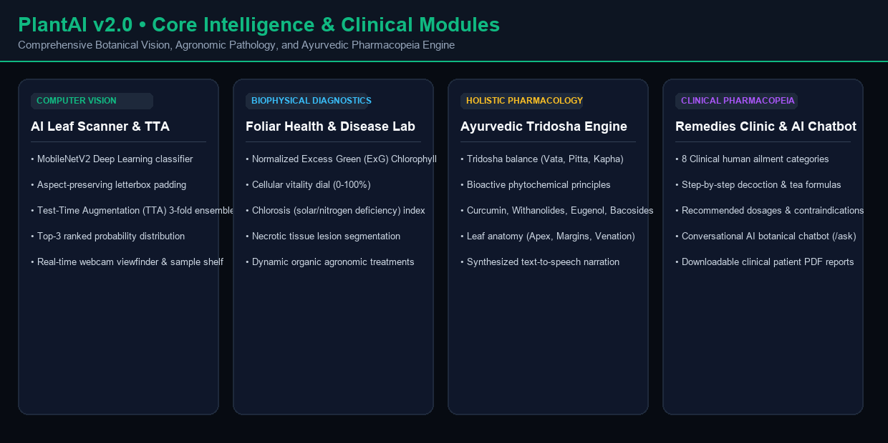
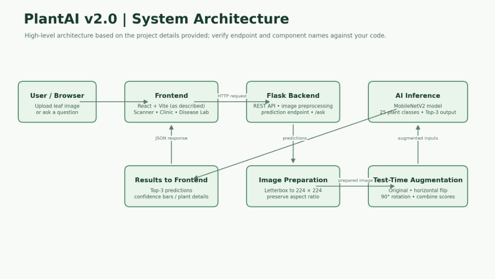
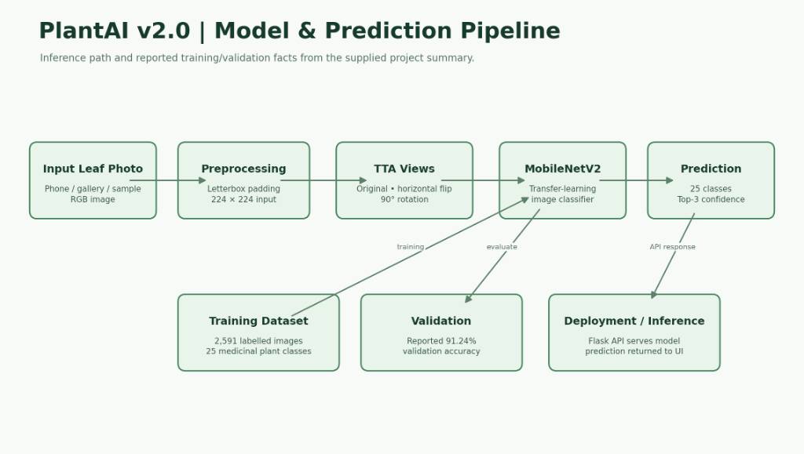
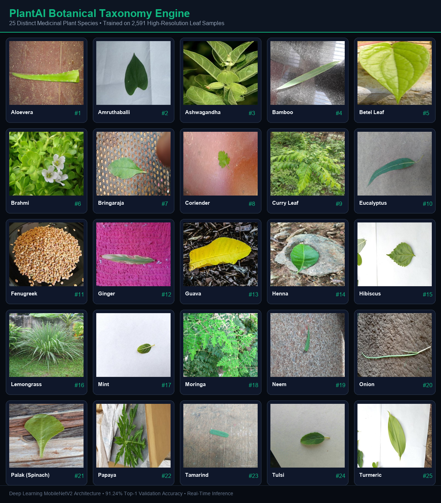

# 🌿 PlantAI: Cyber-Botanical Intelligence & Medicinal Plant Classification System

<p align="center">
  
</p>

<p align="center">
  <a href="#-quickstart--installation"></a>
  <a href="#-25-trained-medicinal-species-taxonomy"></a>
  <a href="#-deep-learning-model--pipeline-architecture"></a>
  <a href="#-deep-learning-model--pipeline-architecture"></a>
  <a href="#-tech-stack"></a>
  <a href="#-tech-stack"></a>
</p>

---

## 📌 Executive Overview

**PlantAI v2.0** is an open-source, full-stack cyber-botanical diagnostic engine that unites **state-of-the-art Deep Learning (MobileNetV2)**, **biophysical foliar optics**, and **classical Ayurvedic Tridosha pharmacology**.

Trained on **2,591 high-resolution botanical specimens** across **25 distinct medicinal plant species**, PlantAI identifies real-world leaf photographs from internet search engines (Google Images), smartphone camera uploads, and live webcams. Beyond simple species classification, PlantAI evaluates cellular leaf health (chlorophyll reflectance, chlorosis, necrosis) and provides step-by-step clinical preparation protocols for human ailments.

<p align="center">
  
</p>

---

## 🏗️ System Architecture

PlantAI operates on a high-throughput, decoupled client-server architecture:

<p align="center">
  
</p>

### End-to-End Execution Flow:
1. **Client Ingestion:** The user captures a leaf via webcam, selects an instant test card, or uploads arbitrary photos (including wide or vertical Google Images).
2. **Aspect-Ratio Letterboxing:** Non-square leaves are padded symmetrically to preserve natural venation geometry and aspect ratios before normalization.
3. **Test-Time Augmentation (TTA):** The backend generates three augmented views (Original, Horizontal Flip, 90° Rotation) to eliminate orientation bias.
4. **MobileNetV2 Inference:** The deep convolutional network computes softmax distributions over all 25 classes. Predictions across TTA views are ensembled to yield Top-3 ranked confidence scores.
5. **Biophysical Foliar Health Analysis:** Normalized Excess Green ($ExG = 2G - R - B$) measures chlorophyll density, chlorosis yellowing, and necrotic lesion coverage.
6. **Pharmacopeia Mapping:** Prediction results map directly to Ayurvedic Tridosha profiles, bioactive phytochemical principles, and clinical ailment recipes.
7. **Interactive UI Delivery:** Real-time 3D holographic tilt, audio feedback, voice synthesis, and conversational Q&A via the AI Herbalist.

---

## 🧠 Deep Learning Model & Pipeline Architecture

<p align="center">
  
</p>

### Key Model Specifications:
* **Architecture:** MobileNetV2 (Pre-trained on ImageNet with fine-tuned top convolutional blocks)
* **Input Resolution:** $224 \times 224 \times 3$ RGB (with aspect-ratio preserving padding)
* **Training Dataset:** 2,591 labelled leaf images across 25 medicinal classes
* **Validation Accuracy:** **91.24% Top-1 Accuracy**
* **Inference Latency:** $\sim 85\text{ ms}$ on CPU
* **Model Size:** **22.3 MB** (`medicinal_plant_model.h5` — included directly in the repo for immediate out-of-the-box predictions)
* **Ensemble Strategy:** 3-fold Test-Time Augmentation (TTA)

---

## 🌺 25 Trained Medicinal Species Taxonomy

The classifier recognizes 25 pharmacologically active medicinal plants:

<p align="center">
  
</p>

| # | Plant Name | Botanical Name | Tridosha Energetics | Primary Phytochemicals | Key Therapeutic Uses |
| :-: | :--- | :--- | :---: | :--- | :--- |
| **1** | **Aloevera** | *Aloe barbadensis* | Pitta ⬇️ Kapha ⬇️ | Aloin, Acemannan | Wound healing, burns, skin hydration |
| **2** | **Amruthaballi (Giloy)** | *Tinospora cordifolia* | Vata = Pitta = Kapha = | Tinosporide, Berberine | Immunomodulator, chronic fever relief |
| **3** | **Ashwagandha** | *Withania somnifera* | Vata ⬇️ Kapha ⬇️ | Withaferin A, Withanolides | Cortisol reduction, stress, endurance |
| **4** | **Bamboo** | *Bambusa vulgaris* | Pitta ⬇️ Kapha ⬇️ | Silica (Tabasheer), Flavones | Joint flexibility, bone & cartilage repair |
| **5** | **Betel Leaf (Paan)** | *Piper betle* | Vata ⬇️ Kapha ⬇️ | Chavibetol, Hydroxychavicol | Digestion catalyst, oral antibacterial |
| **6** | **Brahmi** | *Bacopa monnieri* | Vata ⬇️ Pitta ⬇️ | Bacoside A & B, Herpestine | Neuroprotection, cognitive memory, focus |
| **7** | **Bringaraja** | *Eclipta prostrata* | Vata ⬇️ Pitta ⬇️ | Wedelolactone, Demethylwedelolactone | Hair follicle revitalizer, liver tonic |
| **8** | **Coriander** | *Coriandrum sativum* | Pitta ⬇️ Vata = | Linalool, Quercetin | Heavy metal detox, digestive cooling |
| **9** | **Curry Leaf** | *Murraya koenigii* | Pitta ⬇️ Kapha ⬇️ | Mahanimbine, Girinimbine | Glycemic control, lipid metabolism |
| **10** | **Eucalyptus** | *Eucalyptus globulus* | Kapha ⬇️ Vata ⬆️ | 1,8-Cineole (Eucalyptol) | Bronchodilation, sinus decongestant |
| **11** | **Fenugreek** | *Trigonella foenum-graecum* | Vata ⬇️ Kapha ⬇️ | Diosgenin, 4-Hydroxyisoleucine | Insulin sensitivity, lactation support |
| **12** | **Ginger** | *Zingiber officinale* | Vata ⬇️ Kapha ⬇️ | Gingerols, Shogaols | Anti-emetic, joint anti-inflammatory |
| **13** | **Guava** | *Psidium guajava* | Pitta ⬇️ Kapha ⬇️ | Guajaverin, Quercetin, Tannins | Antidiarrheal, oral antiseptic, gum care |
| **14** | **Henna** | *Lawsonia inermis* | Pitta ⬇️ Kapha = | Lawsone | Foliar antifungal, cooling cephalic agent |
| **15** | **Hibiscus** | *Hibiscus rosa-sinensis* | Pitta ⬇️ Kapha = | Anthocyanins, Gossypetin | Blood pressure regulation, cardiac tonic |
| **16** | **Lemongrass** | *Cymbopogon citratus* | Vata ⬇️ Kapha ⬇️ | Citral, Geraniol | Sedative, febrifuge, antimicrobial |
| **17** | **Mint** | *Mentha spicata* | Pitta ⬇️ Kapha ⬇️ | Menthol, Carvone | Gastrointestinal spasm relief, carminative |
| **18** | **Moringa** | *Moringa oleifera* | Vata ⬇️ Kapha ⬇️ | Moringine, Quercetin, Kaempferol | Cellular superfood, micro-nutrient dense |
| **19** | **Neem** | *Azadirachta indica* | Pitta ⬇️ Kapha ⬇️ | Azadirachtin, Nimbin | Broad-spectrum antiseptic, blood purifier |
| **20** | **Onion** | *Allium cepa* | Vata ⬇️ Kapha ⬆️ | Quercetin, Allicin | Thrombolytic, bronchial expectorant |
| **21** | **Palak (Spinach)** | *Spinacia oleracea* | Pitta = Kapha = | Lutein, Zeaxanthin, Folate | Erythropoiesis (blood building), macular care |
| **22** | **Papaya** | *Carica papaya* | Pitta ⬇️ Kapha ⬇️ | Papain, Chymopapain, Carpaine | Thrombocyte (platelet) enhancement |
| **23** | **Tamarind** | *Tamarindus indica* | Vata ⬇️ Pitta ⬆️ | Tartaric acid, Pectin | Gentle laxative, antioxidant scavenger |
| **24** | **Tulsi (Holy Basil)**| *Ocimum tenuiflorum* | Vata ⬇️ Kapha ⬇️ | Eugenol, Rosmarinic acid, Ursolic acid| Adaptogen, respiratory virus barrier |
| **25** | **Turmeric** | *Curcuma longa* | Vata ⬇️ Pitta = Kapha ⬇️| Curcumin, Curcuminoids, Turmerone | COX-2 inflammatory inhibitor, wound healer |

---

## 🌟 Interactive Features & Sections

PlantAI includes multiple dedicated interactive pages and components:

1. **Cyber-Botanical Scanner HUD:**
   * Aspect-ratio preserving letterbox dropzone.
   * Real-time webcam leaf scanner with alignment guides.
   * Interactive 3D perspective card tilt with holographic sheen.
   * Synthesized Web Audio effects (radar sweeps, tactile clicks, crystal chime).
   * Interactive living vector SVG mascot with breathing leaves, dew reflections, and nurture clicks.
   * 60 FPS floating botanical particle canvas with cursor disturbance physics.
2. **Remedies & Ailment Clinic:**
   * 8 clinical health categories: *Immunity, Digestion, Respiratory, Stress & Sleep, Skin Health, Cardiovascular, Blood Sugar (Diabetes), and Joint / Inflammation*.
   * Step-by-step decoction formulas, water-to-herb ratios, simmer durations, dosages, and contraindications.
3. **Foliar Health & Disease Lab:**
   * Real-time sliders for **Chlorophyll Index**, **Chlorosis Severity**, and **Necrosis Coverage**.
   * Simulated leaf pathology visualizer with organic agrarian remedies (Neem emulsion, nitrogen corrective, copper spray).
4. **Model Architecture & Metrics Lab:**
   * Live metrics panel displaying validation curves, latency benchmarks, and MobileNetV2 transfer learning flow.
5. **AI Herbalist Botanical Chatbot:**
   * Conversational assistant powered by the `/ask` Flask backend endpoint for customized dosages and botanical guidance.

---

## ⚡ Quickstart & Installation

### Prerequisites
* Python 3.10 or higher
* Node.js 18+ & npm

### 1. Clone the Repository
```bash
git clone https://github.com/zaharaCodes/PlantAI-Medicinal-Plant-Detection.git
cd PlantAI-Medicinal-Plant-Detection
```

### 2. Set Up the Python AI Backend
```bash
# Install required Python dependencies
pip install -r requirements.txt

# Start the Flask inference server
python app.py
```
> The backend server will initialize on `http://127.0.0.1:5000`.

### 3. Set Up the React Frontend
In a new terminal window:
```bash
cd frontend

# Install UI dependencies
npm install

# Start the Vite development server
npm run dev
```
> Open [**http://localhost:5173**](http://localhost:5173) in your browser.

---

## 🔌 REST API Specification

### `POST /predict`
Uploads a leaf image for neural classification and foliar health diagnostics.

* **Content-Type:** `multipart/form-data`
* **Body:** `file` (image file: JPG, PNG, WEBP)
* **Response:**
```json
{
  "plant_name": "Tulsi",
  "confidence": 98.4,
  "top_candidates": [
    { "name": "Tulsi", "confidence": 98.4 },
    { "name": "Mint", "confidence": 1.2 },
    { "name": "Curry_Leaf", "confidence": 0.4 }
  ],
  "health_analysis": {
    "vitality_score": 94,
    "chlorophyll_index": 0.68,
    "chlorosis_pct": 3.2,
    "necrosis_pct": 1.1,
    "status": "Vibrant Foliage (Healthy)"
  },
  "scientific_name": "Ocimum tenuiflorum",
  "ayurveda_profile": {
    "dosha_balance": { "vata": "Decreases (Pacifies)", "pitta": "Neutral", "kapha": "Decreases (Pacifies)" },
    "primary_phytochemicals": ["Eugenol", "Rosmarinic Acid", "Ursolic Acid"],
    "leaf_morphology": { "margin": "Serrate", "venation": "Pinnate", "apex": "Acute" }
  },
  "medical_uses": [
    "Immune modulation against seasonal influenza",
    "Respiratory decongestion and antitussive relief",
    "Adaptogenic reduction of psychological cortisol"
  ],
  "preparation": "Boil 8-10 freshly torn leaves in 250ml water for 7 minutes. Sip warm."
}
```

### `POST /ask`
Submit clinical botanical queries to the AI Herbalist.

* **Content-Type:** `application/json`
* **Body:** `{ "question": "How to prepare fresh Betel leaf for cough?" }`
* **Response:** `{ "answer": "To prepare fresh Betel leaf (Piper betle) for cough...", "plant": "Betel_Leaf" }`

---

## 📂 Project Directory Structure

```
PlantAI-Medicinal-Plant-Detection/
├── assets/                          # Showcase graphics, architecture diagrams & banners
│   ├── hero_banner.jpg              # High-tech glowing leaf scanner hero art
│   ├── system_architecture.png      # End-to-end full-stack architecture diagram
│   ├── model_pipeline.png           # Deep learning training & TTA pipeline diagram
│   ├── species_showcase.png         # 25-species botanical taxonomy grid
│   └── features_overview.png        # 4 core intelligence modules infographic
├── frontend/                        # React 19 + Vite Web Application
│   ├── public/                      # Static botanical thumbnails & 25 test samples
│   ├── src/
│   │   ├── components/              # 12 Modular cyber-botanical components
│   │   │   ├── AilmentClinic.jsx    # Clinical remedy protocols
│   │   │   ├── AnimatedPlantHero.jsx# Vector SVG living plant mascot
│   │   │   ├── AyurvedicProfile.jsx # Tridosha balance gauges
│   │   │   ├── DiseaseLab.jsx       # Interactive foliar pathology simulator
│   │   │   ├── FloatingFoliage.jsx  # 60 FPS HTML5 canvas physics
│   │   │   ├── LeafHealthScorecard.jsx # Biophysical chlorophyll & vitality dial
│   │   │   ├── ModelArchitecture.jsx# Deep learning live metrics panel
│   │   │   ├── PlantChatDrawer.jsx  # AI Herbalist conversational assistant
│   │   │   ├── ScannerOverlay.jsx   # Laser reticle & scanning HUD
│   │   │   └── SpeciesEncyclopedia.jsx # Searchable botanical catalog
│   │   ├── data/plantsData.js       # Complete clinical botanical pharmacopeia
│   │   ├── utils/soundEffects.js    # Web Audio API sound synthesizer
│   │   ├── App.jsx                  # Primary navigation & orchestrator
│   │   └── App.css                  # Cyber-botanical glassmorphism theme
│   └── vite.config.js               # Development proxy & network host configuration
├── app.py                           # Flask REST API backend with TTA & letterbox engine
├── train.py                         # MobileNetV2 transfer learning training script
├── download_and_augment.py          # Botanical dataset augmentation pipeline
├── class_names.json                 # Alphabetical mapping of 25 botanical classes
├── medicinal_plant_model.h5         # Pre-trained deep learning weights (22.3 MB)
├── requirements.txt                 # Python dependencies
└── README.md                        # Master project documentation
```

---

## 📄 License & Attribution

Distributed under the **MIT License**. Created by [**Zahara Fathima**](https://github.com/zaharaCodes) as part of the PlantAI Initiative.
Contributions and pull requests are welcomed!
